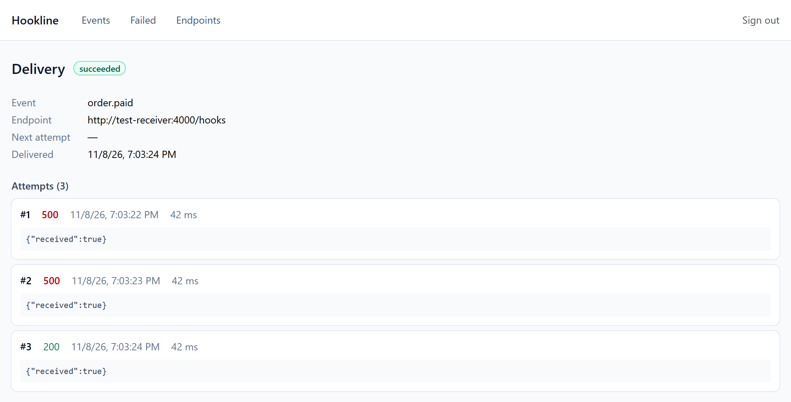

# Hookline

Reliable webhook delivery: publish an event once, and Hookline delivers it at least once or moves it to a dead-letter queue, with an auditable history of every attempt.

> **Status:** early development. Events are delivered, signed, recorded, and retried, and exhausted deliveries go to a dead-letter queue. Endpoint URLs are protected against SSRF, a failing or overloaded endpoint does not hold back the others, and processes shut down without cutting deliveries short. Container images are published for amd64 and arm64, metrics, traces and logs show what every delivery went through, and a web dashboard shows each attempt and retries failed deliveries. Kubernetes and a public deployment come next.

[Leia em português](README.pt-BR.md)



_The dashboard shows every attempt of a delivery, with its HTTP status, duration and response._

## Requirements

- Node.js 26 (see `.nvmrc`)
- pnpm, through Corepack (`corepack enable`)
- Docker with Compose

## Getting started

```bash
pnpm install
pnpm infra:up
pnpm check
```

`pnpm infra:up` starts PostgreSQL and RabbitMQ, bound to localhost only. The RabbitMQ management UI is at <http://localhost:15672>. `pnpm check` includes integration tests, which need Docker running.

## Running locally

Create your local configuration, apply the migrations, and create a project. The API key is shown only once.

```bash
cp .env.example .env
pnpm db:migrate
pnpm project:create demo
```

Run each process in its own terminal:

```bash
pnpm dev:api
```

```bash
pnpm dev:relay
```

```bash
pnpm dev:deliver
```

```bash
pnpm dev:receiver
```

```bash
pnpm dev:web
```

The dashboard is at <http://localhost:5173>: sign in with the API key that `pnpm project:create` printed (it is shown only once) to browse events, see every delivery attempt, retry failed deliveries and manage endpoints. It calls the API on its own origin, and Vite forwards `/v1` to the API. The key stays in the tab's memory, so reloading the page asks for it again.

The API documentation is at <http://localhost:3000/docs>. To send a test webhook, register the test receiver as an endpoint and publish an event, replacing `<API_KEY>`:

```bash
curl -X POST http://localhost:3000/v1/endpoints -H "Authorization: Bearer <API_KEY>" -H "Content-Type: application/json" -d '{"url":"http://127.0.0.1:4000/hooks","event_types":["payment.approved"]}'
```

```bash
curl -X POST http://localhost:3000/v1/events -H "Authorization: Bearer <API_KEY>" -H "Content-Type: application/json" -d '{"type":"payment.approved","payload":{"amount":4200}}'
```

See what arrived at <http://localhost:4000/received>, and the history at `GET /v1/events/:id` and `GET /v1/deliveries/:id`.

## Delivery policy

A delivery gets up to 6 attempts: one right away, then after 1 minute, 5 minutes, 30 minutes, 2 hours, and 6 hours. Any `2xx` response is a success. Any other response, a network error, or a 10-second timeout schedules the next attempt. Redirects are not followed.

- **`410 Gone`:** disables the endpoint and ends the delivery.
- **Disabled or deleted endpoint:** ends the delivery when its next attempt comes up.
- **Exhausted delivery:** gets the `dead` status and a message in `deliveries.dlq`.
- **Schedule over while the circuit is open:** a delivery waiting on an open circuit (below) still ends when its schedule does, about 8 h 36 min after the event, with a last attempt recorded as `DEADLINE_EXCEEDED` and no call to the endpoint.
- **Manual retry:** `POST /v1/deliveries/:id/retry` queues one more attempt for a `dead` delivery whose endpoint is active.

Delivery is at least once, so an endpoint can receive the same event more than once. Use the `webhook-id` header, which stays the same across attempts, to discard repeats.

`RETRY_DELAYS` changes the schedule, for example `2s,2s,2s,2s,2s` for a quick local test.

### Endpoint isolation

- **Circuit breaker:** after 5 failures in a row, Hookline stops calling the endpoint for 5 minutes (`CIRCUIT_OPEN_SECONDS`). Deliveries wait without spending attempts, up to the end of their schedule. The endpoint's `consecutive_failures` and `circuit_open_until` show its state. A success, activating the endpoint again, or changing its URL closes the circuit.
- **Rate limit:** each worker sends at most 50 webhooks per second to each endpoint, set with `ENDPOINT_RATE_LIMIT_PER_SECOND`. Deliveries over the limit wait one second, without spending attempts.

## Publishing safely

- **Repeated requests:** send an `Idempotency-Key` header on `POST /v1/events` to retry a request safely. The same key and content return the original event with `idempotent-replayed: true`. The same key with different content returns `409`.
- **Rate limit:** each project can make 6,000 API requests per minute by default, set with `RATE_LIMIT_PER_MINUTE`. The count is per API process. Past the limit, the API returns `429` with a `retry-after` header.
- **Secret rotation:** `POST /v1/endpoints/:id/rotate-secret` returns a new secret, shown only once. For 24 hours, webhooks carry signatures from both the old and the new secret, so you can switch without rejecting any. Rotating again within that period ends the older secret at once.

## Endpoint URL protection

Hookline calls URLs chosen by its clients, so it blocks requests to internal addresses (SSRF):

- **Allowed URLs:** `https` only, without credentials.
- **Blocked addresses:** private networks, loopback, link-local (including the cloud metadata address `169.254.169.254`), and other reserved ranges, in IPv4 and IPv6.
- **At registration:** the API resolves the hostname and rejects the URL if any address is blocked.
- **On every connection:** the worker checks again and connects to the address it checked, so a DNS answer that changes later cannot reach an internal address. A blocked attempt is recorded with the `SSRF_BLOCKED` error.

`ALLOW_PRIVATE_TARGETS=true` turns this off, so local development can use the test receiver at `http://127.0.0.1`. It is off unless set, and must stay off wherever third parties can register endpoints.

## Shutdown

On `SIGINT` or `SIGTERM`, each process finishes its work in progress before exiting:

- **API:** stops accepting connections and answers the requests in progress.
- **Relay:** finishes the batch it is publishing.
- **Delivery worker:** stops taking messages and waits up to 15 seconds for the deliveries in progress. Messages still running at that point return to the queue, and the duplicate check keeps a recorded attempt from repeating.

A second signal, or 30 seconds without finishing, ends the process at once.

## Production build

`pnpm build` compiles every package to `dist/`, and `node apps/worker/dist/main-deliver.js` runs a process without `tsx`. Each package exports its compiled `dist/` by default and its TypeScript source under the `@hookline/source` condition, which the `dev` scripts, the type checker, and the tests use, so development needs no build.

`pnpm db:migrate` reads `db/migrations` from the repository. Set `MIGRATIONS_DIR` to read them from elsewhere.

## Running in containers

```sh
pnpm stack:up
pnpm stack:smoke
pnpm stack:e2e
pnpm stack:down
```

`pnpm stack:up` builds the images from the `Dockerfile` and starts the whole stack: migrations, API at <http://localhost:3000>, relay, delivery worker, test receiver at <http://localhost:4000>, which endpoints reach as `http://test-receiver:4000/hooks`, and the dashboard at <http://localhost:8080>. It uses the same ports as the `pnpm dev:*` scripts, so run one or the other. `pnpm stack:smoke` publishes an event end to end and stops the delivery worker during a slow delivery to check that the delivery is still recorded. `pnpm stack:e2e` runs the Playwright test of the dashboard (install its browser once with `pnpm --filter @hookline/e2e exec playwright install chromium`): a delivery fails, and the test finds it, reads its attempts, enables its endpoint again and retries it until it succeeds. It needs short retry delays, so start the stack with `RETRY_DELAYS=1s,1s,1s,1s,1s pnpm stack:up`. CI runs both on every pull request.

There are four images. The three Node ones run as the unprivileged `node` user with `node` as process 1:

| Image                    | Command                                                                                                                |
| ------------------------ | ---------------------------------------------------------------------------------------------------------------------- |
| `hookline-api`           | `node dist/server.js` by default; also `node dist/scripts/migrate.js` and `node dist/scripts/create-project.js <name>` |
| `hookline-worker`        | `node dist/main-deliver.js` by default; `node dist/main-relay.js` for the relay                                        |
| `hookline-test-receiver` | `node dist/main.js`                                                                                                    |

`hookline-web` is nginx running as an unprivileged user on port 8080. It serves the dashboard and forwards `/v1` to `API_URL` (`http://api:3000` by default), so the browser sees a single origin and the API needs no CORS. Its responses carry a strict Content Security Policy, `X-Content-Type-Options: nosniff` and `Referrer-Policy: no-referrer`.

Create a project in the running stack with `docker compose --profile app run --rm api node dist/scripts/create-project.js <name>`. It prints the project's API key once, which is what the dashboard asks for; only a hash of it is stored.

## Running in Kubernetes

The same stack runs in a local Kubernetes cluster: k3s, the distribution the production VPS will use, inside Docker through [k3d](https://k3d.io). It needs `k3d` and `kubectl`.

```sh
pnpm k8s:up
pnpm k8s:smoke
pnpm k8s:obs
pnpm k8s:obs-check
pnpm k8s:argocd
pnpm k8s:down
```

- `pnpm k8s:up` creates the `hookline` cluster and a Secret with random passwords and an encryption key, which never go to Git. It then applies `infra/k8s/overlays/local`. The dashboard is at <http://hookline.localhost:8088>; through it, `/v1` reaches the API. Port 8088 keeps it clear of the compose stack.
- `pnpm k8s:project <name>` creates a project and prints its API key.
- `pnpm k8s:smoke` runs the smoke test against the cluster. It deletes the delivery worker's pod during a slow delivery, and checks that the network policies let the API reach Postgres and keep other pods out.
- `pnpm k8s:obs` adds Prometheus, Tempo, Loki, Alloy and Grafana, with the same alerts and dashboard as compose, at <http://grafana.hookline.localhost:8088>. `pnpm k8s:obs-check` checks that they see the app.
- `pnpm k8s:argocd` installs Argo CD, at <http://argocd.hookline.localhost:8088>, read-only without a login. From then on the cluster syncs from `main`, and a change made by hand is undone.

The manifests are in `infra/k8s`: a Kustomize base, a `local` overlay and a `ci` overlay. Every pod has readiness and liveness probes and memory limits. Every pod runs under the `restricted` Pod Security standard: no root, a read-only root filesystem, no capabilities. Network policies deny incoming traffic unless allowed: only Hookline's processes reach Postgres, and only the relay and the delivery worker reach RabbitMQ. Retention runs as a daily CronJob. The `k8s` CI job does all of this on a k3d cluster, with the images built from the pull request.

To deploy a newer `main`, run `pnpm k8s:bump`. It checks that the images of the latest commit on `main` are published and pins `overlays/local` to them. Merge that change through a pull request and Argo CD rolls it out; reverting the commit rolls it back. See ADRs [12](docs/adr/0012-kubernetes-com-k3s.md) and [13](docs/adr/0013-gitops-com-argo-cd.md).

## Observability

```sh
pnpm stack:up
pnpm obs:up
pnpm obs:reload
pnpm obs:down
```

Each process serves `/metrics` (Prometheus format), `/healthz` and `/readyz` on an ops port of its own, which is never the API's public port: `METRICS_PORT`, 9464 in containers, and 9464, 9465 and 9466 for the API, the relay and the delivery worker under `pnpm dev:*`. It listens on `127.0.0.1` unless `METRICS_HOST` says otherwise.

`pnpm obs:up` starts Prometheus at <http://localhost:9090>, Tempo for traces, Loki and Alloy for logs, and Grafana at <http://localhost:3001>, which opens on the "Hookline – visão geral" dashboard. Prometheus scrapes the containers started by `pnpm stack:up` and RabbitMQ's queue metrics. The dashboard and data sources are provisioned from `infra/observability`, so edit the JSON there rather than in the UI. After changing the dashboard or the alert rules, run `pnpm obs:reload`: Prometheus never rereads its rules on its own, and on Docker Desktop for Windows Grafana does not notice a file changed on the Windows side.

| Metric                                                                           | What it shows                                                            |
| -------------------------------------------------------------------------------- | ------------------------------------------------------------------------ |
| `hookline_http_request_duration_seconds`                                         | API latency by method, route and status class                            |
| `hookline_events_accepted_total`, `hookline_deliveries_created_total`            | New events and the deliveries they fanned out to                         |
| `hookline_outbox_pending`, `hookline_outbox_oldest_pending_age_seconds`          | Rows waiting for the relay; a growing age means it stopped               |
| `hookline_outbox_published_total`                                                | Messages published, by kind: `ready`, `wait` or `dead`                   |
| `hookline_delivery_attempts_total`, `hookline_delivery_attempt_duration_seconds` | Attempts by outcome: `succeeded`, `retry`, `dead` or `endpoint_disabled` |
| `hookline_delivery_first_attempt_delay_seconds`                                  | Time from accepting an event to its first attempt, the delivery SLO      |
| `hookline_delivery_deferrals_total`                                              | Messages put back without spending an attempt, by reason                 |
| `hookline_endpoints_circuit_open`                                                | Endpoints with an open circuit breaker                                   |

Labels only take values from small, fixed sets. Per-endpoint detail stays in the database.

### Traces

The API, relay and delivery worker send OpenTelemetry traces over OTLP when `OTEL_EXPORTER_OTLP_ENDPOINT` is set, which the compose stack does, pointing at Tempo. Without it, tracing does not load. The images load it with `node --import @hookline/shared/tracing` before the app, which traces HTTP requests, PostgreSQL queries and the webhook POST, and adds `trace_id` and `span_id` to log lines.

A trace crosses the outbox and the queue by hand: each outbox row stores the W3C trace context of the code that wrote it (`outbox.trace_context`), the relay publishes as a child of it and sends its own context in the message headers, and the delivery worker continues from there. So one trace shows `POST /v1/events`, the database writes, the publish, the delivery attempt and the endpoint's response. A retry, which can come hours later, starts a new trace with a link to the previous attempt's. In Grafana, open Explore, pick Tempo and search, for example, `{ name = "POST /v1/events" }`.

Webhook requests carry a `traceparent` header, so an endpoint that traces can join the same trace.

### Logs

The processes write JSON lines to stdout and nothing else. Alloy reads the containers' logs through the Docker socket and pushes them to Loki, labelled by `service` and `level`. `trace_id` and `span_id` travel as structured metadata rather than labels, since one stream per trace would overwhelm Loki's index. In Grafana, a log line's details link to its trace in Tempo, and a span in Tempo links back to the lines its trace wrote. The dashboard's last row shows warnings and errors.

### Alerts

`infra/observability/prometheus/alerts.yml` holds the alert rules, and `pnpm obs:test-rules` runs their unit tests with promtool, as CI does:

| Alert                      | Fires when                                                                                                |
| -------------------------- | --------------------------------------------------------------------------------------------------------- |
| `HooklineOutboxStuck`      | The oldest pending outbox row is over 60 s old for 2 minutes                                              |
| `HooklineDeadLetters`      | A delivery reached the DLQ in the last 10 minutes                                                         |
| `HooklineFirstAttemptSlow` | The p99 delay to the first attempt is over 5 s for 5 minutes (SLO)                                        |
| `HooklineHighFailureRate`  | Over half the deliveries failed or waited on an open circuit breaker in the last 5 minutes, for 2 minutes |
| `HooklineProcessDown`      | Prometheus cannot scrape a process for a minute                                                           |

Nothing sends notifications yet: firing alerts show on Prometheus's Alerts page and in the dashboard. Each alert links to its runbook (`runbook_url`), in [docs/runbooks](docs/runbooks/README.md) (in Portuguese), which also covers Postgres or RabbitMQ being down and rolling back a version. Incidents are written up in [docs/postmortems](docs/postmortems/README.md).

## Retention

```sh
pnpm db:retention
docker compose --profile app run --rm api node dist/scripts/retention.js
```

The retention script deletes outbox rows published over 7 days ago (`RETENTION_OUTBOX_DAYS`) and events over 30 days old (`RETENTION_EVENT_DAYS`) whose deliveries have all ended, with their deliveries and attempts. It never deletes an event with a delivery still in progress, and it deletes in batches of 1,000 rows, each its own short transaction. Run it daily; in Kubernetes it becomes a CronJob.

## Backup

```sh
pnpm k8s:backup
pnpm k8s:restore-test
pnpm k8s:restore [hookline-<timestamp>.dump]
```

In Kubernetes, a CronJob runs `pg_dump` every night at 02:30 UTC, half an hour before retention, and `rclone` sends the copy to an S3-compatible store in the cluster (the Versity S3 Gateway), which keeps 7 days of copies. `k8s:backup` runs it now. `k8s:restore-test` takes a backup, restores it into a throwaway Postgres and compares every table's row count with the live database; the `k8s` CI job runs it after the chaos test. `k8s:restore` restores a copy over the live database, stopping the API, the relay and the delivery worker meanwhile: everything written after that copy is lost, so read [the restore runbook](docs/runbooks/restore.md) first. Why this design, and its limits (the copy lives in the same cluster; up to a day of data lost): [ADR 14](docs/adr/0014-backup-com-pg-dump-em-s3.md).

## Load tests

```sh
pnpm stack:up
pnpm obs:up
pnpm load:ingest
pnpm load:e2e
```

The k6 scenarios in `load-tests/` run in a container inside the compose network and push their numbers to Prometheus, so the dashboard's "Carga (k6)" row shows the load next to the stack's reaction. `scripts/load.mjs` raises the API and endpoint rate limits (`pnpm stack:up` restores them), creates a project with one endpoint on the test receiver, runs k6 and reports:

- **`load:ingest`** ramps the publish rate up to 800 events/s over 4 minutes (`MAX_RATE`, `RAMP`) and prints, every 15 seconds, the rate offered, the rate accepted and the API's p99.
- **`load:e2e`** holds 200 events/s for 10 minutes (`RATE`, `DURATION`), waits for every delivery to end and checks in the database that each event has a finished delivery, with the delay to the first attempt against the 5 s SLO.

`OTEL_SDK_DISABLED=true` before either command turns tracing off, to measure what it costs. The results are in [docs/capacity.md](docs/capacity.md).

## Chaos test

```sh
pnpm k8s:images
pnpm k8s:up chaos
pnpm chaos
```

`pnpm chaos` publishes 10,000 events at 50/s to three test destinations (one fails 10% of the time, one is down for the first part of the run, one never answers) and, while they flow, kills the delivery worker, the relay, RabbitMQ, one API pod and Postgres. Then it checks every event: each accepted one is in the database once, every delivery ended `succeeded` or `dead`, the test receiver got every successful one, and no outbox row is left. The `chaos` overlay shortens the retry schedule and the circuit breaker so a run takes about 10 minutes. The `k8s` CI job runs a 1,000-event version on every pull request. The result, with the dashboard during the run and the bugs it found, is in [docs/chaos.md](docs/chaos.md).

## Published images

Every merge to `main` publishes the four images for `linux/amd64` and `linux/arm64`, tagged `sha-<commit>` and `main`, and a `v*` tag adds its version:

```sh
docker pull ghcr.io/klebers022/hookline-api:main
```

Before publishing, Trivy scans each image and fails on a critical or high vulnerability that has a fix. Pull requests run the same scan without publishing, and the full report is in the repository's Security tab. Dependabot keeps the base image digest, the GitHub Actions and the npm packages up to date.

## Architecture decisions

See [docs/adr](docs/adr).

## License

[MIT](LICENSE)
