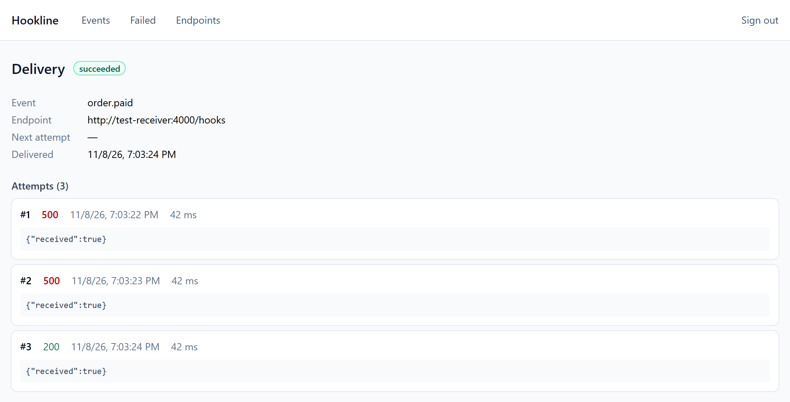

# Hookline

Entrega confiável de webhooks: publique um evento uma vez, e o Hookline o entrega pelo menos uma vez ou o move para uma dead-letter queue, com histórico auditável de cada tentativa.

> **Status:** início do desenvolvimento. Os eventos são entregues, assinados, registrados e reenviados em caso de falha, e as entregas esgotadas vão para uma dead-letter queue. As URLs dos endpoints são protegidas contra SSRF, um endpoint com falha ou sobrecarga não atrasa os outros, e os processos encerram sem interromper entregas. As imagens de contêiner são publicadas para amd64 e arm64, métricas, traces e logs mostram por onde cada entrega passou, e um painel web mostra cada tentativa e reenvia as entregas com falha. Kubernetes e um deploy público vêm a seguir.

[Read in English](README.md)



_O painel mostra cada tentativa de uma entrega, com o status HTTP, a duração e a resposta._

## Requisitos

- Node.js 26 (veja `.nvmrc`)
- pnpm, via Corepack (`corepack enable`)
- Docker com Compose

## Como começar

```bash
pnpm install
pnpm infra:up
pnpm check
```

`pnpm infra:up` sobe o PostgreSQL e o RabbitMQ, acessíveis apenas pelo localhost. O painel de gerenciamento do RabbitMQ fica em <http://localhost:15672>. `pnpm check` inclui testes de integração, que precisam do Docker rodando.

## Como rodar localmente

Crie a configuração local, aplique as migrações e crie um projeto. A API key aparece uma única vez.

```bash
cp .env.example .env
pnpm db:migrate
pnpm project:create demo
```

Rode cada processo em um terminal próprio:

```bash
pnpm dev:api
```

```bash
pnpm dev:relay
```

```bash
pnpm dev:deliver
```

```bash
pnpm dev:receiver
```

```bash
pnpm dev:web
```

O painel fica em <http://localhost:5173>: entre com a API key que o `pnpm project:create` mostrou (ela aparece uma única vez) para ver os eventos e cada tentativa de entrega, reenviar entregas com falha e gerenciar os endpoints. Ele chama a API no próprio endereço, e o Vite repassa `/v1` para a API. A chave fica só na memória da aba, então recarregar a página pede a chave de novo.

A documentação da API fica em <http://localhost:3000/docs>. Para enviar um webhook de teste, cadastre o receptor como endpoint e publique um evento, substituindo `<API_KEY>`:

```bash
curl -X POST http://localhost:3000/v1/endpoints -H "Authorization: Bearer <API_KEY>" -H "Content-Type: application/json" -d '{"url":"http://127.0.0.1:4000/hooks","event_types":["payment.approved"]}'
```

```bash
curl -X POST http://localhost:3000/v1/events -H "Authorization: Bearer <API_KEY>" -H "Content-Type: application/json" -d '{"type":"payment.approved","payload":{"amount":4200}}'
```

Veja o que chegou em <http://localhost:4000/received> e o histórico em `GET /v1/events/:id` e `GET /v1/deliveries/:id`.

## Política de entrega

Uma entrega tem até 6 tentativas: uma imediata e outras depois de 1 minuto, 5 minutos, 30 minutos, 2 horas e 6 horas. Qualquer resposta `2xx` é sucesso. Qualquer outra resposta, erro de rede ou timeout de 10 segundos agenda a próxima tentativa. Redirects não são seguidos.

- **`410 Gone`:** desativa o endpoint e encerra a entrega.
- **Endpoint desativado ou removido:** encerra a entrega quando chega a hora da próxima tentativa.
- **Entrega esgotada:** recebe o status `dead` e uma mensagem em `deliveries.dlq`.
- **Calendário vencido com o circuito aberto:** uma entrega esperando um circuito aberto (abaixo) termina mesmo assim quando o calendário acaba, cerca de 8h36 depois do evento, com uma última tentativa registrada como `DEADLINE_EXCEEDED` e sem chamar o endpoint.
- **Reenvio manual:** `POST /v1/deliveries/:id/retry` agenda mais uma tentativa para uma entrega `dead` cujo endpoint esteja ativo.

A entrega é "pelo menos uma vez", então um endpoint pode receber o mesmo evento mais de uma vez. Use o header `webhook-id`, que não muda entre as tentativas, para descartar repetições.

`RETRY_DELAYS` muda o calendário, por exemplo `2s,2s,2s,2s,2s` para um teste local rápido.

### Isolamento entre endpoints

- **Circuit breaker:** depois de 5 falhas seguidas, o Hookline deixa de chamar o endpoint por 5 minutos. As entregas esperam sem gastar tentativas, até o fim do calendário. Os campos `consecutive_failures` e `circuit_open_until` do endpoint mostram o estado. Um sucesso, a reativação do endpoint ou a troca da URL fecham o circuito.
- **Limite de envios:** cada worker envia no máximo 50 webhooks por segundo a cada endpoint, valor definido em `ENDPOINT_RATE_LIMIT_PER_SECOND`. As entregas acima do limite esperam um segundo, sem gastar tentativas.

## Publicação segura

- **Pedidos repetidos:** envie o header `Idempotency-Key` em `POST /v1/events` para repetir um pedido com segurança. A mesma chave com o mesmo conteúdo devolve o evento original com `idempotent-replayed: true`. A mesma chave com conteúdo diferente devolve `409`.
- **Limite de pedidos:** cada projeto pode fazer 6.000 pedidos por minuto à API por padrão, valor definido em `RATE_LIMIT_PER_MINUTE`. A contagem é por processo da API. Acima do limite, a API devolve `429` com o header `retry-after`.
- **Troca de segredo:** `POST /v1/endpoints/:id/rotate-secret` devolve um novo segredo, mostrado uma única vez. Durante 24 horas, os webhooks levam as assinaturas do segredo antigo e do novo, para você trocar sem rejeitar nenhum. Uma nova troca nesse período encerra o segredo mais antigo na hora.

## Proteção das URLs dos endpoints

O Hookline chama URLs escolhidas pelos clientes, então bloqueia pedidos para endereços internos (SSRF):

- **URLs aceitas:** apenas `https`, sem usuário e senha.
- **Endereços bloqueados:** redes privadas, loopback, link-local (incluindo o endereço de metadados da nuvem, `169.254.169.254`) e outras faixas reservadas, em IPv4 e IPv6.
- **No cadastro:** a API resolve o hostname e recusa a URL se algum endereço for bloqueado.
- **Em cada conexão:** o worker confere de novo e se conecta ao endereço que conferiu, então uma resposta de DNS que mude depois não alcança um endereço interno. Uma tentativa bloqueada fica registrada com o erro `SSRF_BLOCKED`.

`ALLOW_PRIVATE_TARGETS=true` desliga essa proteção, para o desenvolvimento local usar o receptor de teste em `http://127.0.0.1`. Ela fica desligada se não for definida e deve continuar assim onde terceiros podem cadastrar endpoints.

## Encerramento

Ao receber `SIGINT` ou `SIGTERM`, cada processo termina o trabalho em andamento antes de sair:

- **API:** deixa de aceitar conexões e responde os pedidos em andamento.
- **Relay:** termina o lote que está publicando.
- **Worker de entrega:** deixa de pegar mensagens e espera até 15 segundos pelas entregas em andamento. As mensagens que ainda estiverem em execução voltam para a fila, e a checagem de duplicatas impede que uma tentativa já registrada se repita.

Um segundo sinal, ou 30 segundos sem terminar, encerra o processo na hora.

## Build de produção

`pnpm build` compila cada pacote para `dist/`, e `node apps/worker/dist/main-deliver.js` roda um processo sem `tsx`. Cada pacote exporta por padrão o `dist/` compilado e, sob a condição `@hookline/source`, o código TypeScript, usado pelos scripts `dev`, pela checagem de tipos e pelos testes. Assim, o desenvolvimento não precisa de build.

`pnpm db:migrate` lê `db/migrations` do repositório. Defina `MIGRATIONS_DIR` para ler de outra pasta.

## Rodando em contêineres

```sh
pnpm stack:up
pnpm stack:smoke
pnpm stack:e2e
pnpm stack:down
```

`pnpm stack:up` constrói as imagens a partir do `Dockerfile` e sobe a stack inteira: migrações, API em <http://localhost:3000>, relay, worker de entrega, receptor de teste em <http://localhost:4000>, que os endpoints acessam como `http://test-receiver:4000/hooks`, e o painel em <http://localhost:8080>. Usa as mesmas portas dos scripts `pnpm dev:*`, então rode um ou outro. `pnpm stack:smoke` publica um evento de ponta a ponta e para o worker de entrega durante uma entrega lenta, para conferir que ela ainda é registrada. `pnpm stack:e2e` roda o teste Playwright do painel (instale o navegador uma vez com `pnpm --filter @hookline/e2e exec playwright install chromium`): uma entrega falha, e o teste a encontra, lê as tentativas, reativa o endpoint e a reenvia até dar certo. Ele precisa de esperas curtas, então suba a stack com `RETRY_DELAYS=1s,1s,1s,1s,1s pnpm stack:up`. O CI roda os dois em todo pull request.

São quatro imagens. As três de Node rodam com o usuário sem privilégios `node` e com o `node` como processo 1:

| Imagem                   | Comando                                                                                                                |
| ------------------------ | ---------------------------------------------------------------------------------------------------------------------- |
| `hookline-api`           | `node dist/server.js` por padrão; também `node dist/scripts/migrate.js` e `node dist/scripts/create-project.js <nome>` |
| `hookline-worker`        | `node dist/main-deliver.js` por padrão; `node dist/main-relay.js` para o relay                                         |
| `hookline-test-receiver` | `node dist/main.js`                                                                                                    |

A `hookline-web` é um nginx rodando com usuário sem privilégios na porta 8080. Ela serve o painel e repassa `/v1` para `API_URL` (`http://api:3000` por padrão), então o navegador vê uma única origem e a API não precisa de CORS. As respostas levam uma Content Security Policy restrita, `X-Content-Type-Options: nosniff` e `Referrer-Policy: no-referrer`.

Crie um projeto na stack em execução com `docker compose --profile app run --rm api node dist/scripts/create-project.js <nome>`. Ele mostra a API key do projeto uma única vez, e é ela que o painel pede; o banco guarda só o hash.

## Rodando no Kubernetes

A mesma stack roda num cluster Kubernetes local: o k3s, a distribuição que a VPS de produção vai usar, dentro do Docker pelo [k3d](https://k3d.io). Precisa do `k3d` e do `kubectl`.

```sh
pnpm k8s:up
pnpm k8s:smoke
pnpm k8s:obs
pnpm k8s:obs-check
pnpm k8s:argocd
pnpm k8s:down
```

- `pnpm k8s:up` cria o cluster `hookline` e um Secret com senhas e uma chave de criptografia aleatórias, que nunca vão para o Git. Depois aplica o `infra/k8s/overlays/local`. O painel fica em <http://hookline.localhost:8088>, e por ele o `/v1` chega à API. A porta 8088 evita conflito com a stack do compose.
- `pnpm k8s:project <nome>` cria um projeto e mostra a API key dele.
- `pnpm k8s:smoke` roda o teste de fumaça contra o cluster. Ele apaga o pod do worker de entrega durante uma entrega lenta e confere que as NetworkPolicies deixam a API alcançar o Postgres e barram outros pods.
- `pnpm k8s:obs` acrescenta Prometheus, Tempo, Loki, Alloy e Grafana, com os mesmos alertas e painel do compose, em <http://grafana.hookline.localhost:8088>. O `pnpm k8s:obs-check` confere que eles enxergam o app.
- `pnpm k8s:argocd` instala o Argo CD, em <http://argocd.hookline.localhost:8088>, só para leitura sem login. A partir daí, o cluster sincroniza a partir da `main`, e uma mudança feita à mão é desfeita.

Os manifestos ficam em `infra/k8s`: uma base Kustomize e os overlays `local` e `ci`. Todo pod tem probes de prontidão e de vida e limites de memória. Todo pod roda no padrão de Pod Security `restricted`: sem root, com o disco raiz só de leitura e sem _capabilities_. As NetworkPolicies negam o tráfego de entrada que não for liberado: só os processos do Hookline chegam ao Postgres, e só o relay e o worker de entrega chegam ao RabbitMQ. A retenção roda como um CronJob diário. O job `k8s` do CI faz tudo isso num cluster k3d, com as imagens construídas no pull request.

Para colocar uma `main` mais nova no cluster, rode `pnpm k8s:bump`. Ele confere que as imagens do último commit da `main` foram publicadas e fixa o `overlays/local` nelas. Mescle essa mudança por pull request e o Argo CD faz o rollout; reverter o commit volta a versão. Veja as ADRs [12](docs/adr/0012-kubernetes-com-k3s.md) e [13](docs/adr/0013-gitops-com-argo-cd.md).

## Observabilidade

```sh
pnpm stack:up
pnpm obs:up
pnpm obs:reload
pnpm obs:down
```

Cada processo serve `/metrics` (formato do Prometheus), `/healthz` e `/readyz` numa porta de operação própria, que nunca é a porta pública da API: `METRICS_PORT`, 9464 nos contêineres, e 9464, 9465 e 9466 para a API, o relay e o worker de entrega com `pnpm dev:*`. Ela escuta em `127.0.0.1`, a menos que `METRICS_HOST` diga outro endereço.

`pnpm obs:up` sobe o Prometheus em <http://localhost:9090>, o Tempo para os traces, o Loki e o Alloy para os logs e o Grafana em <http://localhost:3001>, que abre no painel "Hookline – visão geral". O Prometheus coleta os contêineres de `pnpm stack:up` e as métricas das filas do RabbitMQ. O painel e as fontes de dados são provisionados a partir de `infra/observability`; para mudar o painel, edite o JSON ali, não na interface. Depois de mudar o painel ou as regras de alerta, rode `pnpm obs:reload`: o Prometheus nunca relê as regras sozinho, e no Docker Desktop para Windows o Grafana não percebe um arquivo alterado do lado do Windows.

| Métrica                                                                          | O que mostra                                                                  |
| -------------------------------------------------------------------------------- | ----------------------------------------------------------------------------- |
| `hookline_http_request_duration_seconds`                                         | Latência da API por método, rota e classe de status                           |
| `hookline_events_accepted_total`, `hookline_deliveries_created_total`            | Eventos novos e as entregas geradas pelo fan-out                              |
| `hookline_outbox_pending`, `hookline_outbox_oldest_pending_age_seconds`          | Linhas esperando o relay; idade crescendo significa que ele parou             |
| `hookline_outbox_published_total`                                                | Mensagens publicadas por tipo: `ready`, `wait` ou `dead`                      |
| `hookline_delivery_attempts_total`, `hookline_delivery_attempt_duration_seconds` | Tentativas por resultado: `succeeded`, `retry`, `dead` ou `endpoint_disabled` |
| `hookline_delivery_first_attempt_delay_seconds`                                  | Tempo entre aceitar o evento e a 1ª tentativa, o SLO de entrega               |
| `hookline_delivery_deferrals_total`                                              | Mensagens adiadas sem gastar tentativa, por motivo                            |
| `hookline_endpoints_circuit_open`                                                | Endpoints com o disjuntor aberto                                              |

Os rótulos só assumem valores de conjuntos pequenos e fixos. O detalhe por endpoint fica no banco.

### Traces

A API, o relay e o worker de entrega enviam traces do OpenTelemetry por OTLP quando `OTEL_EXPORTER_OTLP_ENDPOINT` está definida, o que o compose faz, apontando para o Tempo. Sem ela, o tracing nem é carregado. As imagens o carregam com `node --import @hookline/shared/tracing` antes do app, que passa a rastrear pedidos HTTP, consultas ao PostgreSQL e o POST do webhook, e a incluir `trace_id` e `span_id` nas linhas de log.

O trace atravessa a outbox e a fila à mão: cada linha da outbox guarda o contexto W3C de quem a escreveu (`outbox.trace_context`), o relay publica como filho dele e envia o próprio contexto nos headers da mensagem, e o worker de entrega continua dali. Assim, um único trace mostra o `POST /v1/events`, as gravações no banco, a publicação, a tentativa de entrega e a resposta do endpoint. Uma nova tentativa, que pode vir horas depois, abre um trace novo com um link para o da tentativa anterior. No Grafana, abra o Explore, escolha o Tempo e busque, por exemplo, `{ name = "POST /v1/events" }`.

As requisições de webhook levam o header `traceparent`, então um endpoint que também usa tracing pode entrar no mesmo trace.

### Logs

Os processos só escrevem linhas JSON no stdout. O Alloy lê os logs dos contêineres pelo socket do Docker e os envia ao Loki, com os rótulos `service` e `level`. `trace_id` e `span_id` vão como metadados estruturados, não como rótulos, porque um stream por trace sobrecarregaria o índice do Loki. No Grafana, os detalhes de uma linha de log levam ao trace dela no Tempo, e um span no Tempo leva de volta às linhas que o trace escreveu. A última linha do painel mostra os avisos e erros.

### Alertas

As regras de alerta ficam em `infra/observability/prometheus/alerts.yml`, e `pnpm obs:test-rules` roda os testes delas com o promtool, como o CI faz:

| Alerta                     | Dispara quando                                                                                         |
| -------------------------- | ------------------------------------------------------------------------------------------------------ |
| `HooklineOutboxStuck`      | A linha pendente mais antiga da outbox passa de 60 s por 2 minutos                                     |
| `HooklineDeadLetters`      | Uma entrega chegou à DLQ nos últimos 10 minutos                                                        |
| `HooklineFirstAttemptSlow` | O p99 do atraso até a 1ª tentativa passa de 5 s por 5 minutos (SLO)                                    |
| `HooklineHighFailureRate`  | Mais da metade das entregas falhou ou esperou um disjuntor aberto nos últimos 5 minutos, por 2 minutos |
| `HooklineProcessDown`      | O Prometheus não consegue coletar um processo por um minuto                                            |

Ainda não há envio de avisos: os alertas disparados aparecem na página Alerts do Prometheus e no painel.

## Retenção

```sh
pnpm db:retention
docker compose --profile app run --rm api node dist/scripts/retention.js
```

O script de retenção apaga as linhas da outbox publicadas há mais de 7 dias (`RETENTION_OUTBOX_DAYS`) e os eventos com mais de 30 dias (`RETENTION_EVENT_DAYS`) cujas entregas já terminaram, junto com as entregas e as tentativas. Ele nunca apaga um evento com entrega em andamento e apaga em lotes de 1.000 linhas, cada um numa transação curta. Rode-o uma vez por dia; no Kubernetes, ele vira um CronJob.

## Testes de carga

```sh
pnpm stack:up
pnpm obs:up
pnpm load:ingest
pnpm load:e2e
```

Os cenários do k6 em `load-tests/` rodam num contêiner dentro da rede do compose e enviam os números ao Prometheus, então a linha "Carga (k6)" do painel mostra a carga ao lado da reação da stack. O `scripts/load.mjs` aumenta os limites de pedidos da API e de envio por endpoint (`pnpm stack:up` os restaura), cria um projeto com um endpoint na casa de teste, roda o k6 e relata:

- **`load:ingest`** sobe a taxa de publicação até 800 eventos/s em 4 minutos (`MAX_RATE`, `RAMP`) e mostra, a cada 15 segundos, a taxa oferecida, a aceita e o p99 da API.
- **`load:e2e`** mantém 200 eventos/s por 10 minutos (`RATE`, `DURATION`), espera todas as entregas terminarem e confere no banco que cada evento tem uma entrega concluída, com o atraso até a 1ª tentativa comparado ao SLO de 5 s.

`OTEL_SDK_DISABLED=true` antes de qualquer um dos comandos desliga o tracing, para medir quanto ele custa. Os resultados estão em [docs/capacity.md](docs/capacity.md).

## Imagens publicadas

Todo merge na `main` publica as quatro imagens para `linux/amd64` e `linux/arm64`, com as tags `sha-<commit>` e `main`, e uma tag `v*` acrescenta a versão:

```sh
docker pull ghcr.io/klebers022/hookline-api:main
```

Antes de publicar, o Trivy varre cada imagem e falha com vulnerabilidade crítica ou alta que tenha correção. Os pull requests rodam a mesma varredura sem publicar, e o relatório completo fica na aba Security do repositório. O Dependabot mantém atualizados o digest da imagem base, as GitHub Actions e os pacotes npm.

## Decisões de arquitetura

Veja [docs/adr](docs/adr).

## Licença

[MIT](LICENSE)
