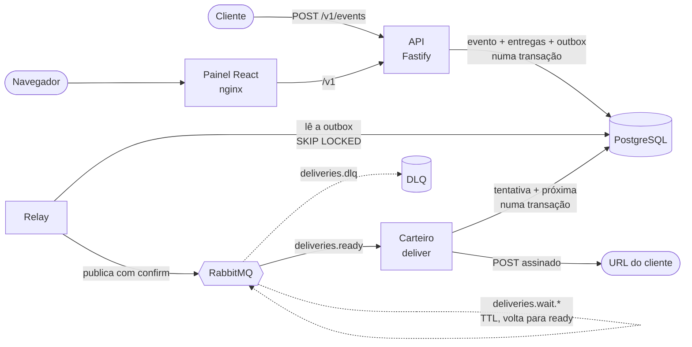
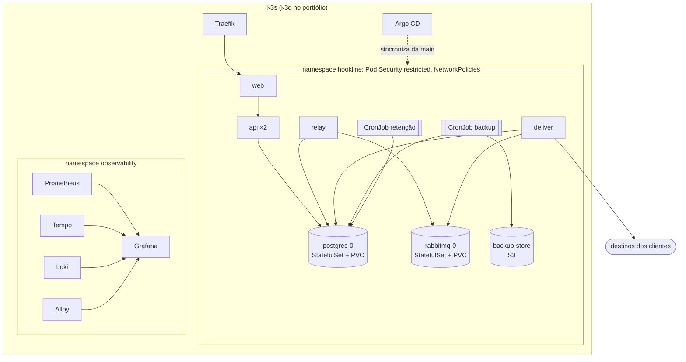

# Arquitetura

O Hookline entrega webhooks de forma confiável. O cliente publica um evento uma vez, e o Hookline garante uma de duas saídas, sempre com o histórico de cada tentativa:

- a entrega a cada destino inscrito, **pelo menos uma vez**;
- ou a ida para o setor de não entregues (DLQ).

Este documento mostra como as peças se encaixam e por que a garantia se sustenta mesmo quando elas caem. As decisões, com as alternativas descartadas, estão nas [ADRs](adr/).

## Visão geral



| Processo                                 | Na analogia dos Correios | O que faz                                                                                        |
| ---------------------------------------- | ------------------------ | ------------------------------------------------------------------------------------------------ |
| API (`apps/api`)                         | balcão                   | autentica pela API key, valida, grava e responde `202`. Nunca chama um destino.                  |
| PostgreSQL                               | livro de registros       | a fonte da verdade: eventos, entregas, tentativas e a outbox.                                    |
| Relay (`apps/worker`, `main-relay`)      | triagem                  | publica as linhas pendentes da outbox no RabbitMQ e as marca como publicadas.                    |
| RabbitMQ                                 | esteira                  | a fila de entregas prontas, as filas de espera entre tentativas e a DLQ.                         |
| Carteiro (`apps/worker`, `main-deliver`) | carteiro                 | faz o POST assinado, registra o resultado e agenda a próxima tentativa.                          |
| Painel (`apps/web`)                      | guichê                   | eventos, tentativas, falhas, reenvio e cadastro de endpoints, pelo navegador.                    |
| Casa de teste (`apps/test-receiver`)     | casa de teste            | um destino que falha, demora ou conta o que recebeu, sob comando; só para testes e demonstração. |

## O caminho de um evento

```mermaid
sequenceDiagram
    autonumber
    participant C as Cliente
    participant A as API
    participant P as Postgres
    participant R as Relay
    participant Q as RabbitMQ
    participant D as Carteiro
    participant U as Destino

    C->>A: POST /v1/events (Idempotency-Key)
    A->>P: BEGIN; evento, 1 entrega por endpoint inscrito, 1 linha de outbox por entrega; COMMIT
    A-->>C: 202 Accepted
    R->>P: linhas pendentes (FOR UPDATE SKIP LOCKED)
    R->>Q: publica {delivery_id, attempt: 1} e espera o confirm
    R->>P: marca published_at
    Q->>D: mensagem
    D->>P: a tentativa 1 já está registrada? Se sim, descarta
    D->>U: POST assinado (webhook-id, webhook-timestamp, webhook-signature)
    U-->>D: 500
    D->>P: BEGIN; tentativa 1 falhou; outbox para deliveries.wait.1m; COMMIT
    D->>Q: ack
    Note over Q: 1 minuto depois, a mensagem expira e volta para deliveries.ready
    Q->>D: {delivery_id, attempt: 2}
    D->>U: POST assinado (mesmo webhook-id)
    U-->>D: 200
    D->>P: tentativa 2, entrega succeeded
    D->>Q: ack
```

**Por que nada se perde nesse caminho:**

1. **A API grava tudo numa transação** (outbox transacional, ADR 0003). Quando o cliente recebe `202`, o evento, as entregas e as linhas da outbox existem juntos. Se a API cair antes do `COMMIT`, o cliente não recebe `202` e reenvia. Com a mesma `Idempotency-Key`, o reenvio não duplica o evento.
2. **O relay só marca uma linha como publicada depois do confirm do RabbitMQ.** Se cair entre os dois passos, ele publica de novo, e o carteiro deduplica.
3. **A mensagem diz qual tentativa é.** O carteiro descarta a mensagem cuja tentativa já está registrada. Por isso uma mensagem repetida, de um relay que republicou ou de um carteiro que caiu antes do `ack`, não gera uma tentativa a mais (ADR 0004).
4. **A próxima tentativa é agendada na mesma transação que registra a atual,** pela outbox, não publicando direto. Ou as duas coisas acontecem, ou nenhuma.
5. **O `ack` vem depois do `COMMIT`.** Um carteiro que cai no meio deixa a mensagem voltar para a fila.

O que a garantia permite é a **duplicata**: um destino pode receber a mesma entrega duas vezes. O header `webhook-id` não muda entre tentativas, para o destino deduplicar.

## A política de entrega

| Situação                                                        | O que acontece                                                                                    |
| --------------------------------------------------------------- | ------------------------------------------------------------------------------------------------- |
| Resposta `2xx`                                                  | `succeeded`                                                                                       |
| Outra resposta, erro de rede, tempo esgotado (10 s) ou redirect | nova tentativa: imediata, depois +1 min, +5 min, +30 min, +2 h e +6 h (6 no total, cerca de 8h36) |
| A 6ª tentativa falha                                            | `dead`, e a mensagem vai para a DLQ                                                               |
| `410 Gone`                                                      | o endpoint é desativado, e a entrega vai para `dead`                                              |
| URL que resolve para um IP interno                              | `SSRF_BLOCKED`, segue a política normal                                                           |
| 5 falhas seguidas num endpoint                                  | o disjuntor abre: as entregas esperam sem gastar tentativa (ADR 0008)                             |
| O calendário acaba com o disjuntor aberto                       | `dead` com `DEADLINE_EXCEEDED`                                                                    |
| Envio acima do limite por endpoint                              | a mensagem espera na primeira fila de espera, sem prender o carteiro                              |

**As esperas são filas, não temporizadores** (ADR 0005). Cada intervalo tem a sua fila (`deliveries.wait.1m`, `deliveries.wait.5m`…), com um TTL próprio e dead-lettering de volta para `deliveries.ready`. São filas quorum com `x-dead-letter-strategy: at-least-once`, para a mensagem não se perder na volta. O reenvio manual de uma entrega `dead` dá uma tentativa nova, pelo painel ou por `POST /v1/deliveries/:id/retry`.

## Segurança

- **Assinatura:** padrão [Standard Webhooks](https://www.standardwebhooks.com/), HMAC-SHA256 sobre `id.timestamp.corpo`. Na troca de segredo, os dois segredos assinam por 24 h, para o cliente trocar sem perder avisos.
- **API keys:** só o hash SHA-256 é guardado. O painel guarda a chave apenas na memória da aba (ADR 0011).
- **Segredos dos endpoints:** guardados com AES-256-GCM, com a chave vinda do ambiente.
- **SSRF:** o IP é validado no momento da conexão, e a conexão usa esse mesmo IP, o que barra o DNS rebinding.
  - Bloqueia faixas privadas, loopback, link-local, metadados de nuvem, IPv6 local e IPv4 dentro de IPv6.
  - Recusa URLs com usuário e senha.
- **Limites:** por projeto, na API; por endpoint, no carteiro.

## Como roda



- **Contêineres** (ADR 0009): TypeScript compilado, Node sem root e sem npm na imagem final. As imagens são `amd64` e `arm64`, varridas pelo Trivy e publicadas no GHCR com a tag do commit.
- **Kubernetes** (ADR 0012): Kustomize com uma base e os overlays `local`, `ci` e `chaos`.
  - Postgres e RabbitMQ em StatefulSets próprios.
  - Sondas de partida, prontidão e vida, e limites de memória, em todos os pods.
  - Padrão `restricted`: sem root, sistema de arquivos só de leitura, sem capabilities.
  - NetworkPolicies negam a entrada por padrão: só os processos do Hookline alcançam o Postgres, e só o relay e o carteiro alcançam o RabbitMQ.
- **GitOps** (ADR 0013): o Argo CD aplica o que está na `main`, com as imagens fixadas por SHA. Voltar uma versão é um `git revert`.
- **Backup** (ADR 0014): `pg_dump` diário para um armazenamento S3, com a restauração testada no CI.
- **Sem produção pública** (ADR 0015): tudo isso roda no k3d, o mesmo k3s da VPS que não saiu.

## Observabilidade

Detalhes na ADR 0010.

- **Métricas:** cada processo serve `/metrics` numa porta interna (9464), lida pelo Prometheus. Os rótulos não levam IDs de projeto nem de endpoint, para não explodir a cardinalidade.
- **Traces:** um evento tem um trace só, do `POST /v1/events` à entrega.
  - O contexto W3C atravessa a outbox numa coluna própria e segue nos headers da mensagem.
  - Cada nova tentativa abre um trace curto, ligado ao anterior por um _span link_.
- **Logs:** JSON do Pino, com `trace_id`, coletados pelo Alloy e guardados no Loki. No Grafana, uma linha de log leva ao trace dela.
- **Alertas:** cinco regras com testes no `promtool`, cada uma com o seu [runbook](runbooks/README.md):
  - outbox parada;
  - entregas na DLQ;
  - SLO da 1ª tentativa;
  - taxa de falhas;
  - processo fora do ar.

## O que sustenta essas afirmações

| Afirmação                                         | Prova                                                                                                                                                               |
| ------------------------------------------------- | ------------------------------------------------------------------------------------------------------------------------------------------------------------------- |
| Nada aceito se perde sob falhas                   | [teste de caos](chaos.md): 10 mil eventos com o carteiro, a triagem, o RabbitMQ, uma API e o Postgres derrubados; uma versão curta roda em cada PR                  |
| A entrega começa em até 5 s                       | [capacidade](capacity.md): 100% das primeiras tentativas dentro do SLO a 200 e a 300 eventos/s, por 10 minutos                                                      |
| As regras de entrega funcionam                    | testes de integração com Postgres e RabbitMQ reais (Testcontainers): duplicatas, queda do relay, carteiro morto antes do `ack`, SSRF, disjuntor, rotação de segredo |
| O backup restaura                                 | `pnpm k8s:restore-test` no CI, e um ensaio que apagou os eventos e os restaurou                                                                                     |
| Um evento com falha se diagnostica pelo navegador | teste Playwright no CI: falha, diagnóstico e reenvio pelo painel                                                                                                    |
