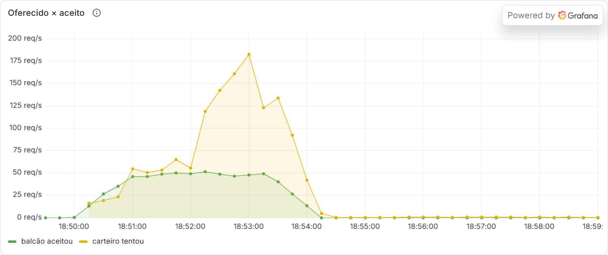
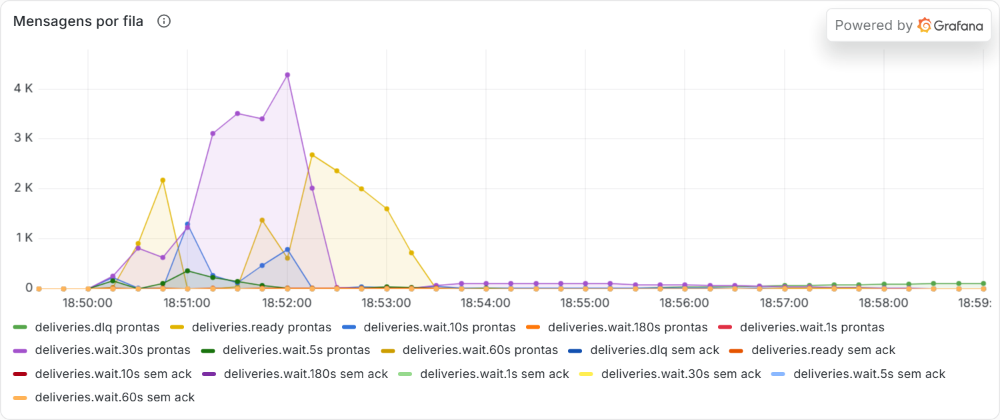
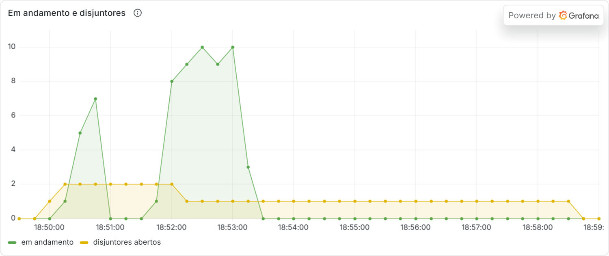
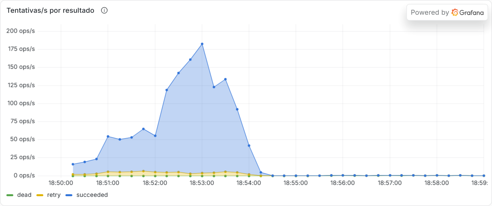

# Teste de caos

A promessa do Hookline é que **cada evento aceito termina entregue ou no setor de não entregues (DLQ), nunca perdido**. Este teste prova a promessa com números: envia 10 mil eventos e, enquanto eles passam, derruba um por um os processos de que a entrega depende. No fim, confere evento por evento.

Rodada registrada aqui: 13 de novembro de 2026, no k3d local, com o código da `main` depois do #46.

## Como rodar

```sh
pnpm k8s:images
pnpm k8s:up chaos
pnpm k8s:obs        # opcional: o painel do Grafana durante a rodada
pnpm chaos          # --events 10000 --rate 50 por padrão
```

O overlay `chaos` (`infra/k8s/overlays/chaos`) é o `ci` com três mudanças:

- **Calendário curto:** `RETRY_DELAYS=5s,10s,30s,60s,180s` (285 s no total), em vez de 1 min a 6 h. É a mesma política, com esperas curtas.
- **Disjuntor curto:** `CIRCUIT_OPEN_SECONDS=15`, em vez de 300.
- **Limites altos:** os limites de pedidos e de envio por destino foram aumentados, para não serem eles o que se mede.

O cluster não pode estar com o Argo CD sincronizando: o `selfHeal` desfaria o overlay. O script confere isso antes de começar.

O job `k8s` do CI roda uma versão curta em cada PR (`--events 1000 --rate 20`).

## O cenário

O k6 (`load-tests/chaos.js`) publica a 50 eventos/s. Cada evento leva uma `Idempotency-Key`, e um pedido que falha é repetido com espera crescente (até 30 vezes). Assim, um evento recusado durante uma queda não vira duplicata quando é repetido.

**Três destinos, três finais esperados.** A casa de teste responde por nome (`/hooks/:nome`):

| Destino  | Comportamento                                              | Final esperado                                          |
| -------- | ---------------------------------------------------------- | ------------------------------------------------------- |
| `flaky`  | 10% de respostas 500, ao acaso                             | todas `succeeded`, algumas depois de nova tentativa     |
| `outage` | 503 durante os primeiros 60% do envio, depois 200          | todas `succeeded`, depois de o disjuntor abrir e fechar |
| `broken` | sempre 500; só recebe o tipo `chaos.rare` (1% dos eventos) | todas `dead` e na DLQ                                   |

**As falhas, em sequência:**

| Momento | Falha                                 | O que testa                                                           |
| ------- | ------------------------------------- | --------------------------------------------------------------------- |
| 22 s    | carteiro morto (SIGKILL)              | a mensagem sem `ack` volta e é deduplicada pela tentativa             |
| 52 s    | triagem (relay) morta (SIGKILL)       | a outbox é republicada sem perda                                      |
| 82 s    | RabbitMQ morto (SIGKILL)              | as filas quorum em disco sobrevivem, e os outros processos reconectam |
| 112 s   | uma das duas APIs desligada (SIGTERM) | a outra atende sozinha                                                |
| 122 s   | o destino `outage` volta              | o disjuntor fecha, e as entregas adiadas saem                         |
| 142 s   | Postgres morto (SIGKILL)              | a API recusa enquanto ele volta; nada aceito se perde                 |

## Resultado

```text
k6: 9632 events accepted, 13 requests retried after a failure, 0 given up, 369 not sent in time

destination   deliveries  succeeded       dead   attempts  received  duplicates
flaky               9632       9632          0      10645      9632           1
outage              9632       9632          0       9666      9632           3
broken                96          0         96        143         0           0

PASS  Every failure was caused: 6 of 6
PASS  Every event sent was accepted: 0 given up
PASS  Every accepted event is in the database, once: 9632 accepted, 9632 rows, 9632 distinct
PASS  Every delivery ended: 9632 + 9632 + 96 expected
PASS  The flaky destination got all of its deliveries: 9632 succeeded, 9632 received
PASS  The destination that came back got all of its deliveries: 9632 succeeded, 9632 received
PASS  Every delivery to the broken destination is dead: 96 dead, 96 of them when the schedule ended with the circuit open
PASS  The dead letter queue got them: 96 added
PASS  No outbox row left unpublished: 0 left
```

O envio terminou aos 203 s, e a última entrega terminou aos 511 s. As 96 entregas do destino `broken` levaram o calendário inteiro (285 s) antes de irem para a DLQ.

**Como ler a prova:**

- **Nenhum evento aceito se perdeu.** Os 9.632 aceitos (`202`) estão no banco, uma vez cada, e cada um tem as entregas esperadas, todas terminadas.
- **A casa de teste confirma pelo outro lado.** Ela conta os `webhook-id` únicos que recebeu com resposta 2xx: 9.632 em cada destino que funciona.
- **Duplicatas aparecem, à parte.** A garantia é "pelo menos uma vez", então duplicatas são permitidas: 4 nesta rodada (1 + 3), contadas em vez de escondidas. O destino deduplica pelo `webhook-id`, que não muda entre tentativas.
- **"369 not sent in time" não é perda.** São iterações que o k6 não chegou a começar, porque os seus usuários virtuais estavam ocupados repetindo pedidos durante a queda do Postgres. Esses eventos nunca foram enviados, então nunca foram aceitos. Um cliente de verdade os enviaria depois.
- **Nenhum pedido desistiu.** Os 13 pedidos que falharam (tempo esgotado ou `503` durante as quedas) foram aceitos na repetição, sem duplicar o evento, graças à `Idempotency-Key`.

## No painel

As capturas são do painel "Hookline – visão geral", no Grafana do cluster, durante a rodada (horários em UTC; o envio começou às 18:49:54).

**O balcão aceita a ~50/s, e o carteiro esvazia o atraso depois.** A aceitação cai a zero quando o envio termina, às 18:53:17. A queda do Postgres, às 18:52:16, durou poucos segundos e mal aparece na média do gráfico. O pico do carteiro entre 18:52 e 18:54 é o destino `outage` voltando, com todas as entregas que esperavam por ele:



**As filas de espera seguram o que não pôde ser entregue.** A `wait.30s` cresce enquanto o destino `outage` responde 503; a `ready` enche quando ele volta; a `dlq` sobe devagar, com as entregas do `broken` chegando ao fim do calendário:



**Disjuntores:** dois abertos (`outage` e `broken`) até o `outage` voltar, e depois só o do `broken` até a última entrega dele morrer:



**Tentativas por resultado:** quase tudo `succeeded`; os `retry` são os 10% do `flaky`:



## O que o caos encontrou

As primeiras rodadas falharam, e cada falha era um problema real, corrigido no seu próprio PR antes de seguir:

| Problema                                                                                                                            | Sintoma no caos                                                                                         | Correção                                                                                                                     |
| ----------------------------------------------------------------------------------------------------------------------------------- | ------------------------------------------------------------------------------------------------------- | ---------------------------------------------------------------------------------------------------------------------------- |
| Com o disjuntor aberto, os adiamentos não gastam tentativa, então um destino sempre fora do ar segurava as entregas indefinidamente | a rodada curta levou 14 min, com o destino `broken` drenando uma entrega por abertura do disjuntor      | #44: um prazo, a criação do evento mais o calendário inteiro; vencido, a entrega vai para `dead` com `DEADLINE_EXCEEDED`     |
| Uma conexão do pool que o Postgres encerra (`57P01`, _admin_shutdown_) emitia `error` sem ninguém ouvindo                           | a API e o relay caíram quando o Postgres reiniciou                                                      | #45: todo pool e toda conexão ganham um ouvinte; uma transação com a conexão quebrada a destrói em vez de devolvê-la ao pool |
| A sonda de vida do Postgres contava "ainda não atendo" como morte                                                                   | o Kubernetes matou o Postgres no meio da recuperação, e ele ficou 84 s fora; a ingestão parou por 3 min | #46: `startupProbe` de até 5 min, e a sonda de vida só falha quando ele não responde                                         |
| O balanceador do k3d (um nginx) aceita 1.024 conexões por padrão                                                                    | pedidos presos na porta por minutos, sem chegar ao Traefik                                              | `infra/k8s/k3d.yaml` sobe o limite para 16.384 (só o ambiente local)                                                         |

## Limites desta prova

- **Uma máquina só.** O cluster, o k6, a observabilidade e os testes rodam no mesmo notebook (Docker com 12 CPUs e 8 GB). Os tempos variam com a carga da máquina; a prova de nenhuma perda não depende deles.
- **Nó único.** Postgres e RabbitMQ têm uma réplica cada, como na v1 (ADR 9). A queda deles para a ingestão por alguns segundos; o que o teste prova é que nada aceito se perde, não que a ingestão nunca para.
- **Calendário curto.** O overlay usa esperas de segundos. A política é a mesma da produção, com tempos menores.
